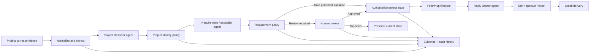
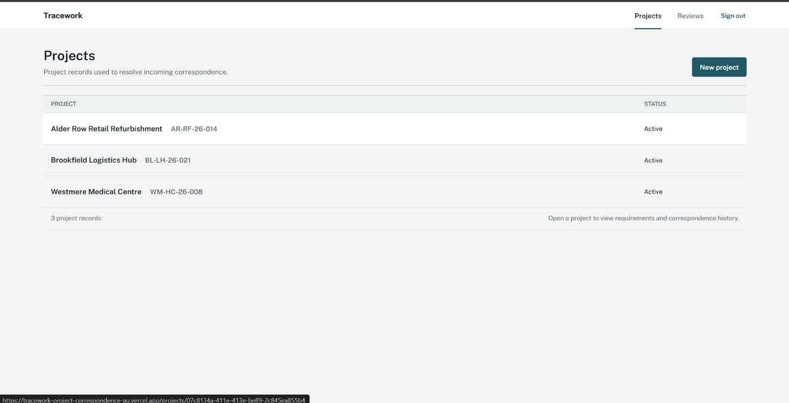
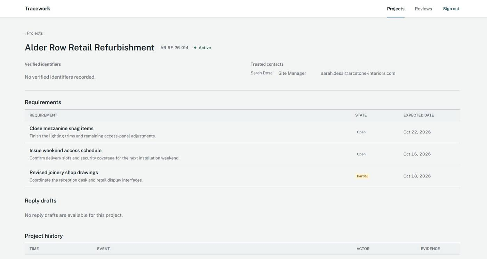
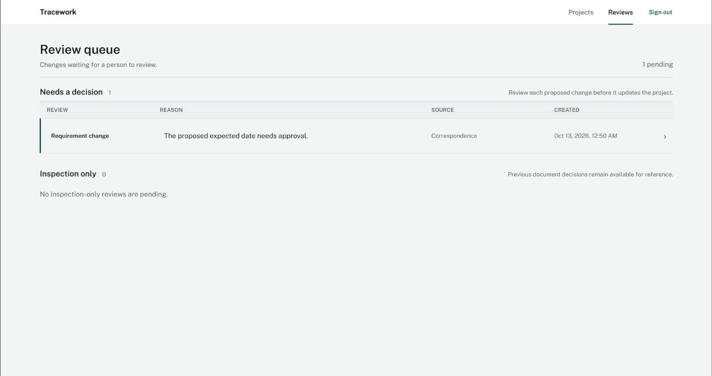
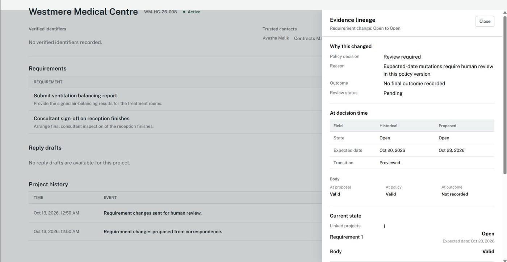
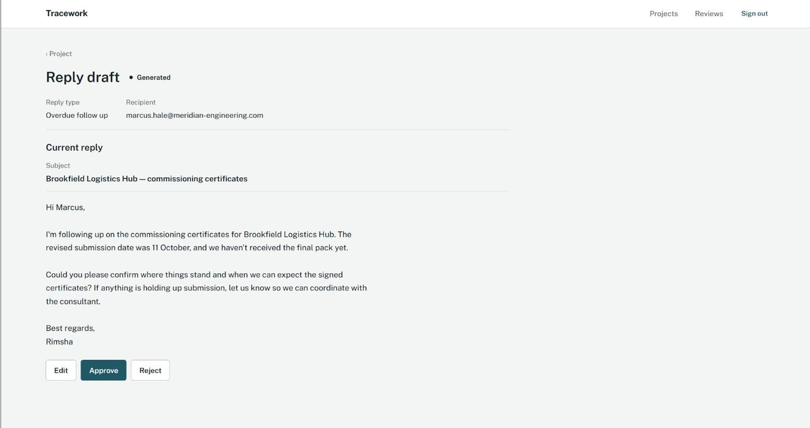

# Tracework

Evidence-backed project correspondence automation with human-controlled state changes.

Tracework turns incoming project communication into structured, auditable project state. Specialized AI agents resolve the relevant project, reconcile requirements, and draft follow-ups, while deterministic policy and human review control whether authoritative records are allowed to change.

[Live demo](https://tracework-project-correspondence-au.vercel.app)

> The hosted API uses Render's free tier, so the first request after a period of inactivity can take longer while the service starts.

## What it does

Project teams make commitments through email, attachments, revised documents, and follow-up threads. Tracework keeps those communications connected to the project state they affect.

The workflow can:

- ingest and normalize project correspondence
- resolve correspondence to the correct project
- extract and preserve supporting evidence
- reconcile new information against existing requirements
- apply deterministic policy before any authoritative mutation
- route ambiguous or higher-risk changes to a human review queue
- preserve corrections, retractions, and historical evidence
- schedule follow-ups for outstanding commitments
- generate grounded reply drafts for operator approval
- maintain an auditable history from correspondence to final state

The language model proposes interpretations. It does not directly mutate authoritative project records.

## Example: Westmere Medical Centre

A project update proposes moving the expected date for the ventilation balancing report from **20 October 2026** to **23 October 2026**.

Tracework resolves the correspondence to Westmere Medical Centre, links the relevant evidence, and proposes the date change. Because expected-date mutations require review, the existing project state remains unchanged until a person approves the proposal.

The review and lineage views keep the original state, proposed state, supporting correspondence, policy decision, and eventual outcome connected instead of silently overwriting project history.

## How it works

Tracework uses AI for semantic interpretation and drafting. Project authorization, mutation policy, review application, evidence validity, and state transitions are enforced in application code.

## AI agents

Tracework uses three focused agents instead of one generic assistant:

| Agent | Role |
| --- | --- |
| Project Resolver | Identifies which project an incoming message belongs to and returns evidence-backed candidate signals. |
| Requirement Reconciler | Compares new correspondence with current requirements and proposes additions, updates, corrections, or retractions. |
| Reply Drafter | Builds a grounded follow-up from scoped project context when an outstanding commitment needs a response. |

The agents only propose structured outputs. Deterministic policy and human review decide whether project state can change.

## Product walkthrough

### Project workspace

The workspace keeps active projects, project codes, requirements, contacts, correspondence history, follow-ups, reply drafts, and activity in one place.

### Track requirements against project communication

Each project keeps its current requirements and expected dates separate from the correspondence that may propose a change.

### Hold risky changes for human review

Changes that should not be applied automatically enter a review queue with the reason they need a decision.

### Inspect evidence lineage

The lineage view connects a proposed change to the historical value, proposed value, supporting evidence, policy decision, and current authoritative state.

### Prepare grounded follow-ups

Outstanding commitments can produce reply drafts grounded in project context. The operator can edit, approve, or reject a draft before any email is sent.

## Product rules

- AI proposals do not directly mutate authoritative project state.
- Uncertain project resolution is held for review instead of guessing a project link.
- New requirements, expected-date changes, completion claims, corrections, and retractions pass through deterministic policy and review rules.
- Only narrowly permitted low-risk transitions can apply automatically.
- Evidence remains linked to the correspondence and decision that produced a change.
- Corrections and retractions preserve history rather than deleting the previous record.
- A retraction cannot partially invalidate an obligation when independent valid supporting evidence still remains.
- Reply drafts require operator approval before Gmail delivery.
- Send/retry handling is designed to avoid duplicate outbound messages.

## Correspondence and evidence

Tracework treats correspondence as evidence, not as direct truth.

Email and attachment processing normalize incoming communication before project resolution and requirement reconciliation. Supporting excerpts are persisted and linked through proposals, policy decisions, reviews, and state transitions so the UI can explain why a project value changed.

Document handling also supports revision history and Google Drive filing workflows without making Drive part of the decision logic.

## Follow-ups and reply drafting

Outstanding dated requirements can create scheduled follow-ups. When a follow-up becomes due, the Reply Drafter agent receives scoped, read-only project context and prepares a structured draft.

The operator controls the final action:

- edit the generated draft
- approve it for sending
- reject it
- retry recoverable delivery failures without creating duplicate sends

Gmail delivery and follow-up completion are persisted as part of the same auditable workflow.

## Authentication and workspace model

Tracework is an authenticated internal operator workspace. Supabase Auth issues access tokens, and the FastAPI backend verifies them through Supabase JWKS before protected project, review, lineage, and reply-draft APIs are served.

There is no public signup by design: operator accounts are provisioned by the workspace owner rather than created through self-service registration. The current product is intentionally a shared internal workspace rather than a public multi-tenant SaaS.

## Evaluation

The repository includes a deterministic evaluation harness and a frozen held-out scenario suite covering project resolution, requirement reconciliation, review routing, evidence grounding, corrections, retractions, stale-content safety, and mutation safety.

Evaluation results are kept separate from production state, and provider/runtime failures are distinguished from behavioral outcomes.

## Tech stack

| Area | Tools |
| --- | --- |
| Frontend | React, TypeScript, Vite, Tailwind CSS, TanStack Query, React Router |
| Backend | Python 3.12, FastAPI, Pydantic, SQLAlchemy, Alembic |
| Agent layer | PydanticAI, Gemini, Groq, OpenRouter |
| Data | PostgreSQL, Supabase PostgreSQL |
| Authentication | Supabase Auth, JWT verification with JWKS |
| Integrations | Gmail API, Google Drive API, PyMuPDF |
| Deployment | Vercel, Render, Supabase |

## Deployment

Frontend: [tracework-project-correspondence-au.vercel.app](https://tracework-project-correspondence-au.vercel.app)

Backend health: [tracework-project-correspondence.onrender.com/health](https://tracework-project-correspondence.onrender.com/health)
